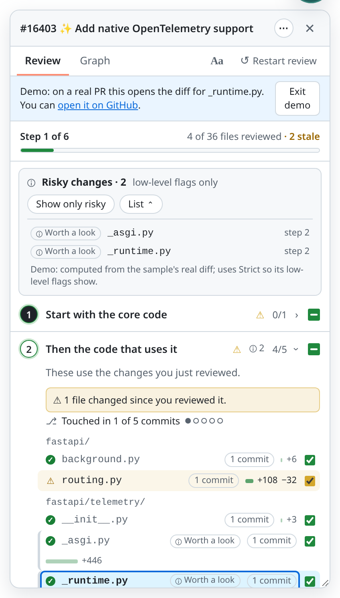
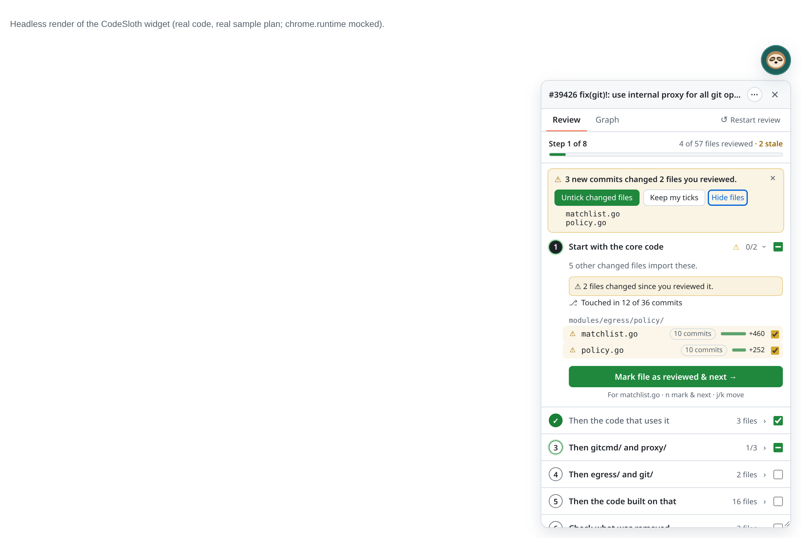
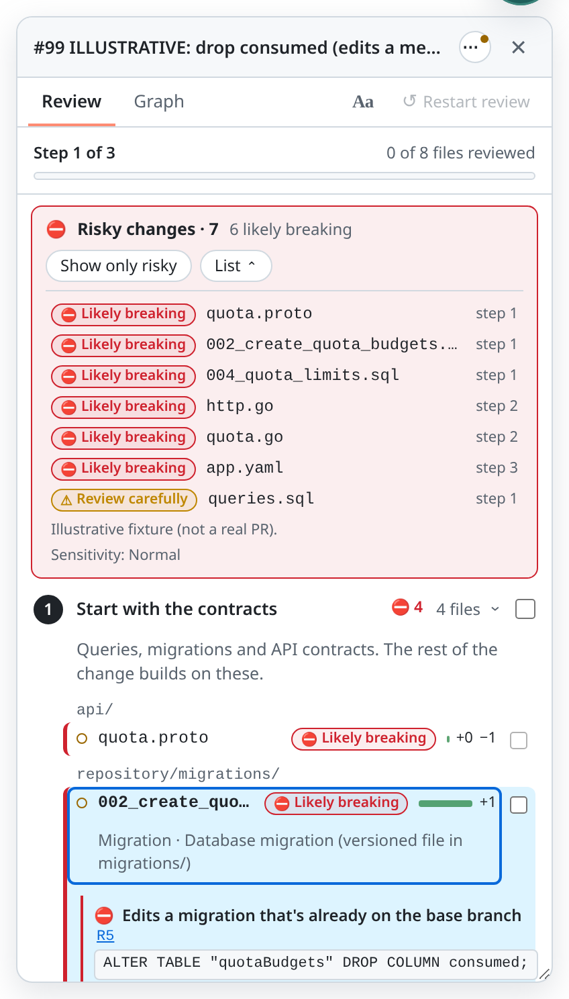
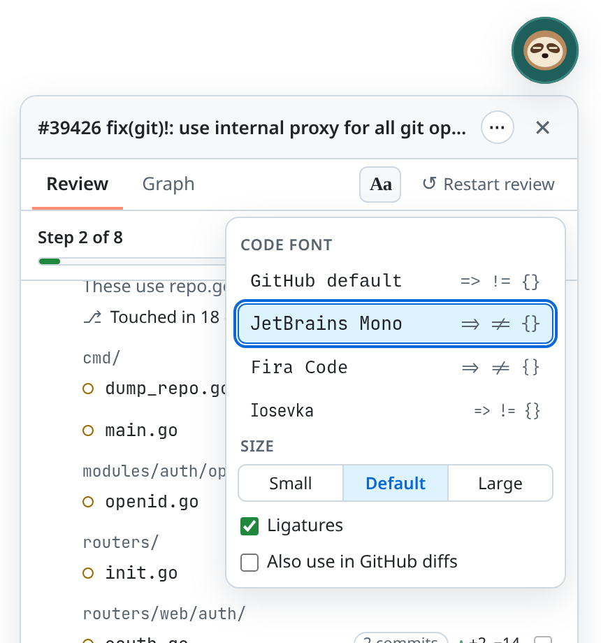
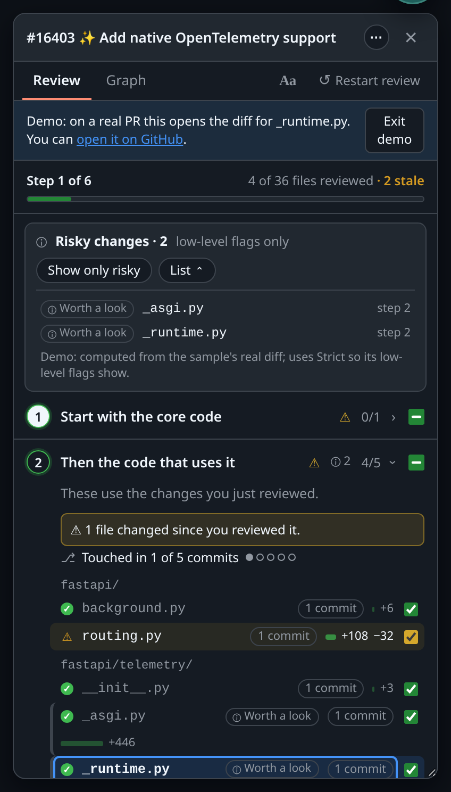

# CodeSloth

**Take your time and actually read the code.** Review big GitHub PRs in a sensible order.

CodeSloth is a browser extension for **human** code review on github.com. It reads a large pull request and turns it into a short checklist of **ordered steps** (contracts and schemas first, then the core code, then the code that uses it, then tests, config and lockfiles), so you can review bottom-up, one step at a time, without changing the repo or the PR. No AI: the order comes from file types and a real import graph, and the risk flags come from rules.

## Features

### Ordered review steps, each with a reason

- The PR is split into **numbered steps** in reading order, e.g. *Start with the core code* → *Then the code that uses it* → *Then applications.py* → *Now the tests* → *Then config and docs* → *Skim the lockfile last*.
- Each step has **one line on why it comes now**, worked out from the PR itself: *"5 other changed files import this."*, *"These cover 4 files above; 13 have no direct match."*, *"Check what was removed: nothing changed still imports this code."*
- Files are grouped by folder with a status dot (new / modified / renamed / deleted) and a +/− bar. **Hover a file** to see how it connects: *"Imported by routing.py and 3 others"*, *"Tests for _api.py"*, *"Lockfile for the pyproject.toml change"*.
- Languages: JS/TS, React (JSX/TSX), Vue SFCs, Node.js (ESM and `require`), Go and Python. Tests are paired with the files they cover; generated files and lockfiles go last.
- The first time you open it, a short **tour** walks you through it. **⋯ → Try demo** loads a real public PR (no token needed).

### Review file by file: Mark & next, Previous and shortcuts

- **Click a file** to select it and jump to its diff in Files changed.
- **Mark file as reviewed & next →** ticks the selected file, selects the next one and jumps to it. After a step's last file it opens the next step. At the end you get **All N files reviewed**.
- **← Previous** undoes the last *Mark & next*: it unticks that file and takes you back to it. Press it again to keep stepping back.
- Every file and every step also has its own checkbox, and the progress line shows where you are: *Step 2 of 6 · 12 of 36 files reviewed*.
- **Keyboard** (while the panel has focus): **n** mark & next · **p** previous · **j / k** next / previous file · **r** next risky file · **Esc** close. They never fire while you're typing in GitHub.
- Ticks are saved per PR, in this browser.

### Stale reviews banner

If new commits change files you already reviewed, their ticks **turn amber (⚠ stale)** instead of silently staying green, and a banner says what happened: *"3 new commits changed 2 files you reviewed."* Choose **Untick changed files** to re-read just those, or **Keep my ticks**. A force-push is called out as such. While the panel is closed, the bubble shows an amber dot.

### Restart review

**↺ Restart review** in the tab row clears every tick for the PR after an inline confirm, takes you back to step 1, and offers **Undo** for a few seconds.

### Commit story

See how each file got to its final state:

- an **N commits** chip on each file, and **Latest: <message> · 2 days ago** under the selected file;
- a collapsible **Commit history** timeline for the selected file (latest 3, *Show all*), with author, +/− and a link to each commit;
- **Touched in X of Y commits** for each step;
- hints: **After review** (a `fixup!` / "address review comments" commit touched it) and **Late change** (only the newest commit touched it).

### Graph view

The **Graph** tab draws the changed files as a layered dependency graph: one band per step, in review order, with a legend that doubles as a step filter. Hover a file to highlight what it uses and what uses it; dashed lines link tests to their subjects; Go packages and import cycles are boxed; big PRs are clustered by folder. Search, pan, zoom, and click a node to jump to its diff. **⤢ Expand** opens it near full screen, **↗ Tab** in its own tab.

### Risky changes (red / amber)

CodeSloth flags changes that tend to break things **after** they compile and pass tests:

- **⛔ Likely breaking** (red): e.g. dropping or renaming a column, editing a migration that's already on the base branch, `NOT NULL` without a default, removing an HTTP route, removing a config key the code still reads, removing a proto field without `reserved`.
- **⚠ Review carefully** (amber): e.g. new public routes, new writes or upserts to an existing table, a changed exported data-layer signature, a major dependency bump, a changed default.
- **ⓘ Worth a look** (low, Strict only): e.g. a new env var with a default.

It covers **SQL and migrations**, **config, env, Docker, Kubernetes, Terraform, CI and dependencies**, the **data layer** (Go, Python, JS/TS, and SQLAlchemy, Django, Pydantic, Prisma, TypeORM, Mongoose, Sequelize) and **API contracts** (HTTP routes, protobuf, GraphQL, OpenAPI, package exports). Generated files are lowered and pointed at their source; shared library paths are raised.

- A **Risky changes · N** banner with **Show only risky** and a **List** of flagged files; counts on each step; a red or amber border and chip on each flagged file; rings on graph nodes.
- **Select a file** to see each reason with the matched line, why it matters, and a **line link** (e.g. **R178**) straight to that line of the diff.
- **Not breaking** dismisses a flag for that PR (with Undo).
- Settings: **Relaxed** (red only), **Normal** (red + amber) or **Strict** (all), and on/off per category. A repo can tune the rules in a `.codesloth.yml` on its base branch.

More: [a real PR with one amber file](docs/images/risky-gitea.png) · [graph rings](docs/images/risky-graph.png) · [dark theme](docs/images/risky-changes-dark.png).

### Smooth scroll to the diff

Selecting a file (from the list, the graph, Mark & next or the keyboard) **smooth-scrolls** GitHub's Files changed page to that file, just below GitHub's sticky header, with a brief highlight. It works with GitHub's lazily rendered diff view, and from the Conversation or Commits tab it opens Files changed at that file. It respects *reduced motion*.

### GitHub Viewed sync (optional)

Turn on **Sync with GitHub Viewed** and marking a file reviewed in CodeSloth also ticks GitHub's own **Viewed** checkbox (and unticks it on undo or Restart). It clicks GitHub's checkbox on the page for you, exactly as you would, so the token stays read-only. If it can't find the checkbox, the row shows a small ⊘ and nothing breaks.

### Fonts, including OpenDyslexic

Click **Aa** to choose the code font in the panel: GitHub default, **JetBrains Mono**, **Fira Code**, **Iosevka** or **OpenDyslexic** (a dyslexia-friendly typeface), with size (Small / Default / Large) and ligatures. **Use for all panel text** applies it to headings and reasons too, and **Also use in GitHub diffs** applies it to the diff itself. All fonts are bundled (SIL Open Font License); nothing is downloaded.

### A floating widget, in Chrome, Arc, Edge and Brave

- A small **sloth bubble** on every PR page. Click it, the toolbar icon, or press **Alt+Shift+L** to open the panel.
- **Drag** it to either edge and anywhere vertically; it remembers where you put it. Resize the panel by its bottom edge.
- It follows GitHub's light and dark themes, survives GitHub's in-page navigation, and stays out of GitHub's own UI.
- Works in **Chrome, Arc, Edge and Brave** (Manifest V3).

### Privacy and read-only

- **Read-only:** it only makes `GET` requests to `api.github.com`, using a fine-grained token you create with read-only access to pull requests and contents. Tokens GitHub reports as write-capable (classic PATs, write scopes) are refused.
- **Local:** there's no CodeSloth server. Your code and your token never leave your browser; results and ticks are stored on your device.

---

Install, token setup, development, architecture and known limitations: [docs/DEVELOPMENT.md](docs/DEVELOPMENT.md).
