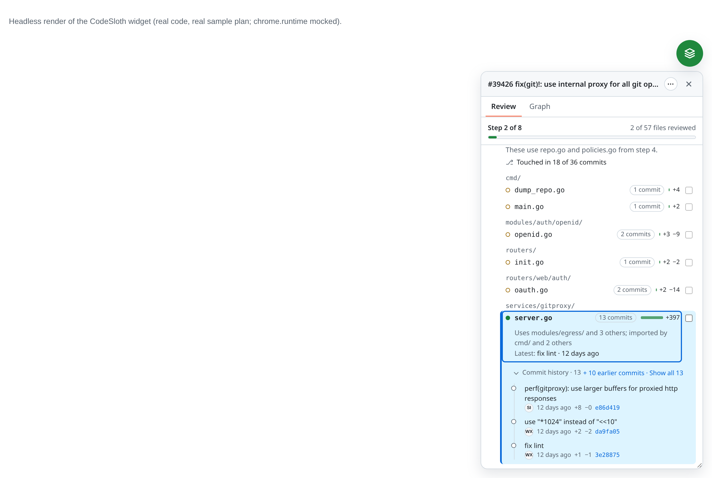
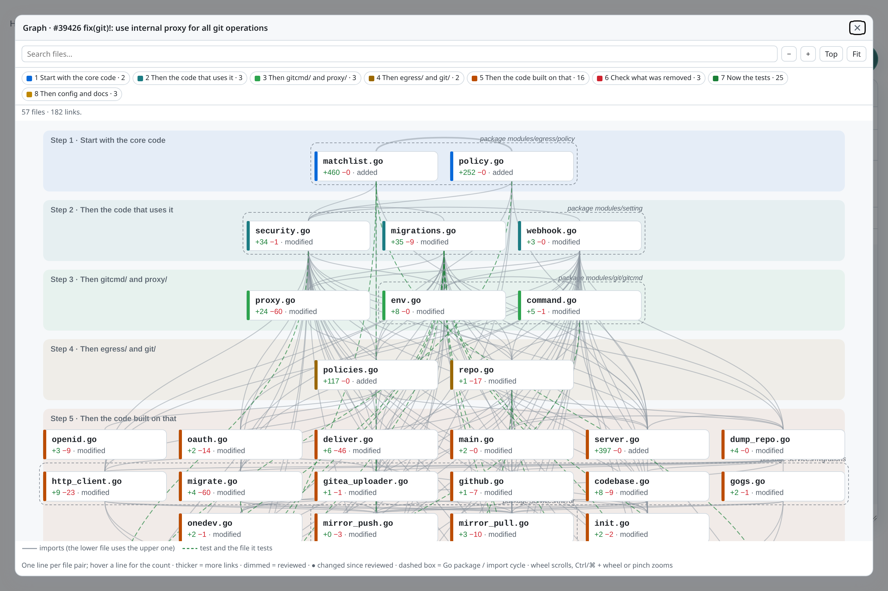
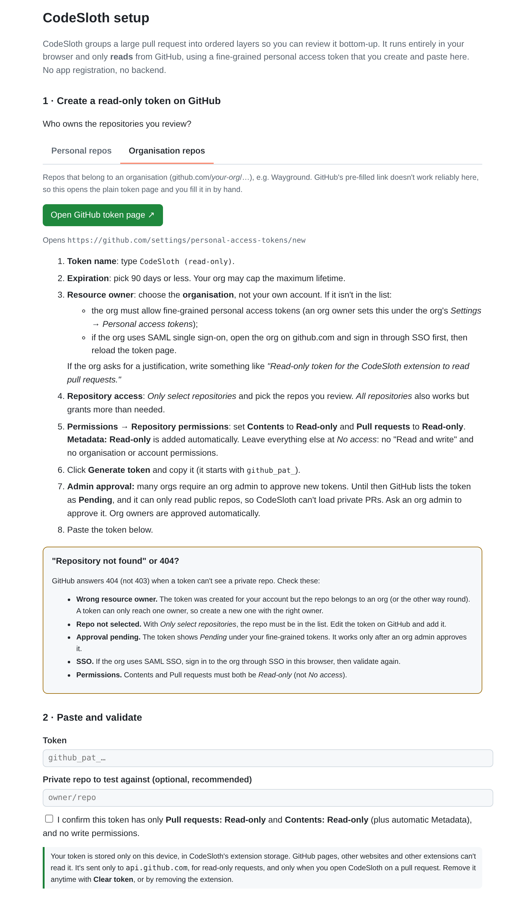
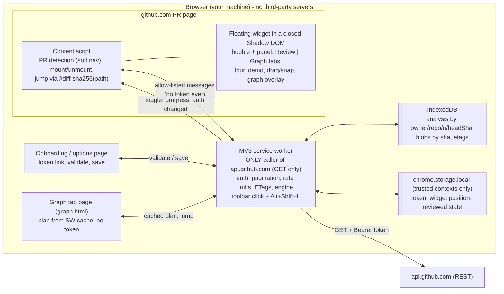

# CodeSloth

**Take your time and actually read the code.** Review big GitHub PRs in a sensible order.

CodeSloth is a browser extension (Manifest V3; Chrome, Arc, Edge, Brave) for **human** code review. It reads a large GitHub pull request and groups its files into ordered **layers**:

> mechanical → contracts & schemas → core → callers (by import depth) → standalone → deleted code → tests → config/docs/assets → generated & lockfiles

You can then review bottom-up, one step at a time. The steps show up as a **checklist in a floating, draggable widget** on the PR page. Each step has a short heading and one line on why it comes now (e.g. *"Start with the core code: 5 other changed files import this."*). Hover a file to see how it connects (e.g. *"Uses _api.py; imported by applications.py"*), click it to jump to it in **Files changed**, and use **Mark file as reviewed & next →** (or **n**) to move through the PR file by file.

- **Read-only.** It only sends `GET` requests, using a fine-grained token you create with *Pull requests: Read-only* and *Contents: Read-only*.
- **Local.** There's no backend. PR code never leaves your browser. Results are cached in IndexedDB.
- **Deterministic.** Layers come from path/type rules plus a real import graph. No AI is involved.
- **Languages:** JS/TS, React (JSX/TSX), Vue SFCs (`<script>` / `<script setup>`), Node.js (ESM + `require`), Go, Python.

This is the Week-1 MVP of the reviewer-side "virtual stack" described in the product plan. It doesn't change the repo or the PR.

---

> **Renamed from PR Layers (v0.6.0).** The extension, repo (`yashverma2110/codesloth`) and zip (`codesloth.zip`) are now called CodeSloth. Nothing about how it works changed. Storage keys were never named after the product (`auth.pat`, `widget.position`, `reviewed.*`, `pref.*`) and the IndexedDB cache keeps its internal name, so your token, ticks and settings carry over. One catch: Chrome ties an unpacked extension's data to the folder it was loaded from. To keep them, **unzip the new build over your existing folder and click ↻ Reload** on the extensions page instead of loading a new folder. Loading it from a new folder gives it a new ID and a fresh start (you'd paste your token again).

## Install (load unpacked)

1. Get the build. Download `codesloth.zip` from the repo's **Releases** (v0.6.0+; older releases call it `pr-stacks-extension.zip`) and unzip it, or build it yourself (`npm ci && npm run build` gives you `dist/`).
2. Open your browser's extensions page and turn on **Developer mode**:
   - Chrome / Brave: `chrome://extensions` / `brave://extensions`
   - Edge: `edge://extensions` (toggle at the bottom left)
   - Arc: `arc://extensions`, or Arc menu → Extensions → Manage extensions
3. Click **Load unpacked** and select the unzipped folder (or `dist/`).
4. The **setup page opens automatically** on first install. You can reopen it from the extension's **Details → Extension options**, or with **Set up token** inside the widget.
5. Open any PR on github.com. A round teal **CodeSloth bubble** (the sloth face) appears at the bottom-right.

### Using the widget

- **Open/close:** click the bubble, click the toolbar icon (on a PR tab), or press **Alt+Shift+L** (⌥⇧L on macOS). Close with ✕ or **Esc**. Esc is ignored while you're typing in a GitHub text field.
- **Move it:** drag the bubble or the panel header. On release it snaps to the left or right edge. You can put it anywhere vertically; it's kept below GitHub's header and inside the window. The side and vertical position are remembered across pages and restarts; a resized height lasts until you leave the page. A drag never counts as a click.
- **Panel:** it opens toward the middle of the screen (downward if the bubble is in the top half, upward otherwise). Drag its bottom edge to resize; lists scroll inside it.
- **Tabs:** **Review** (the step checklist) and **Graph** (dependency graph). They're GitHub-style underline tabs with `tablist`/`tab`/`tabpanel` roles: ←/→ switch, Home/End jump to first/last. The last tab you used is remembered.
- **⋯ menu:** Re-analyze (ignores the cache), Take the tour, Try demo / Exit demo, and Token & settings. It also shows the technical details: head commit and whether the result is cached, GitHub API quota left, total files and +/− lines, and any analysis warnings (a dot on ⋯ means there's a warning).
- The bubble only appears on `/{owner}/{repo}/pull/{n}` pages. It follows GitHub's in-page navigation and disappears on other pages. A red dot means no token is set yet.
- Theme follows GitHub's `data-color-mode` (light/dark/auto), or your OS setting.
- Change the shortcut at `chrome://extensions/shortcuts` (or the equivalent page in your browser).

### Browser support

| Browser | Status |
|---|---|
| Chrome 110+ | Supported |
| Edge, Brave | Supported (Chromium MV3; same APIs) |
| Arc | Supported. v0.2 removed the `chrome.sidePanel` dependency because Arc doesn't implement it. The setup page opens with `chrome.runtime.openOptionsPage()`, falling back to a normal tab. |

v0.3.0 was smoke-tested in **headless Chrome 154 on live github.com** (no token, demo mode): the setup page opens on install, the bubble mounts on a PR's Files changed page, the setup prompt, Try demo, the tour and the Graph tab render. Arc, Edge and Brave haven't been tried yet. See [Known limitations](#known-limitations).

## How to use the Review tab

The Review tab is a **checklist of numbered steps** in reading order. At the top, one line shows where you are, e.g. **Step 2 of 6 · 2 of 36 files reviewed**, with a thin progress bar. Progress counts **files**. When every file is reviewed it reads **All 36 files reviewed**.

1. **Steps.** Each step has a number (✓ once all its files are reviewed), a short plain heading (up to two lines) and a file count (*1/5* when partly reviewed). Only the **current step** is open, meaning the first one with a file that isn't reviewed yet or has changed since. The others are collapsed rows; click one (or press Enter/Space on it) to open it. The open step shows one short why line, worked out from the PR's import graph and file kinds. For fastapi/fastapi#16403 (the bundled demo):

   | Step | Heading | Why |
   |---|---|---|
   | 1 | Start with the core code | 5 other changed files import this. |
   | 2 | Then the code that uses it | These use the changes you just reviewed. |
   | 3 | Then applications.py | This uses routing.py and 2 others from step 2. |
   | 4 | Now the tests | These cover 4 files above; 13 have no direct match. |
   | 5 | Then config and docs | Settings and docs for this change. |
   | 6 | Skim the lockfile last | A lockfile; skim only. |

   Other kinds of step:
   - **Contracts** are named after what changed, e.g. *Start with the types: 27 other changed files build on these.* (excalidraw/excalidraw#12018), or *Start with the schemas*, *…the migrations*, *…the schemas and queries*. With three or more kinds the heading is *Start with the contracts* and the why line lists them (*Schemas, queries and migrations. 12 other changed files build on these.*).
   - **Deleted code** reads *Check what was removed: Nothing changed still imports this code.* That line only appears when no changed file still imports it. Otherwise the step names the files that do. A deleted Go file whose package still exists gets a "check it" line instead, because imports can't tell.
   - **Standalone:** *No imports to or from other changed code.*
   - **Deeper callers** are named after what's in them: one file (*Then applications.py*), or one or two folders (*Then gitcmd/ and proxy/*). If that file name also exists elsewhere in the PR, its folder is added (*Then services/quota_allocation.go* and *Then controllers/quota_allocation.go*); if two steps would still share a heading, a longer folder path is tried first. Otherwise they're *Then the code built on that*, and two such steps in a row are numbered (*Then the code built on that (1 of 2)*).
   - When a big step is split by package, the why line starts with its folder (*In packages/a/.*).
2. **Files** are grouped by folder; the shared path is shown once. Each row shows:
   - a **status dot**: filled = new, hollow = modified, dashed = deleted, square = renamed/copied. Hover for the label; screen readers get it too. Once a file is reviewed, a green ✓ replaces the dot and the row is muted.
   - the file name;
   - a small **+N bar**, with **−N** only when lines were removed;
   - a **checkbox** to mark or unmark that one file.

   **Hover or focus** a file to see how it connects (*Imported by routing.py and 3 others*, *Uses _api.py*, *Tests for _api.py*, *Lockfile for the pyproject.toml change*). **Click it** (or press Enter) to **select** it and jump to its diff in Files changed. The selected file gets an accent left border and background and `aria-current`, and its reason stays visible. Reviewed files can be selected too.
3. **Mark file as reviewed & next →** on the open step marks the selected file reviewed. If nothing in that step is selected, it marks the step's first unreviewed file. Then it selects the next unreviewed file in the step and jumps to its diff. After the step's last file, it collapses the step, opens the next step that still has unreviewed files, selects that step's first one and jumps there. For the last file in the PR the button reads **Mark file as reviewed ✓**, and the panel then shows **All N files reviewed**. The step checkbox marks all its files reviewed, or unmarks them all; it shows a mixed state when only some are reviewed.

   **← Previous** sits to the left of that button (a compact ghost button; just **←** when the panel is narrow). It undoes the last *Mark file as reviewed & next*: it unticks the file you most recently marked that way, selects it again, reopens its step if it was collapsed, and smooth-scrolls to its diff. Press it again to keep stepping back. If **Sync with GitHub Viewed** is on and CodeSloth ticked GitHub's Viewed for that file, it unticks Viewed too. The history is kept per PR for this browser session only (in memory, so a page reload clears it). Entries whose tick is already gone are skipped: files you unticked yourself, files removed by **Untick changed files**, and everything after **Restart review** (Restart's Undo brings the history back). **Keep my ticks** keeps them. The button is disabled when there's nothing to undo, and also appears next to **All N files reviewed** once you're done.
4. **Keyboard:** everything is a real button or checkbox (Tab, Enter, Space). While focus is in the panel, and not in a text field like the graph search, **n** = mark & next, **p** = previous (undo the last mark & next), **j / k** = select the next / previous file (in review order, opening steps as needed). These keys never fire while you're typing in GitHub.
5. **⚠ Changed since you reviewed it (stale ticks).** Each reviewed file stores its blob SHA. If a later push changes a reviewed file, its tick is **kept but marked stale**: an amber ⚠ instead of the ✓ and an amber checkbox, with a *Changed since you reviewed* tooltip that lists the new commits that touched it when the commit story knows them. Its step shows ⚠, stale files don't count as reviewed, and the progress line says so (*4 of 57 files reviewed · 2 stale*). Review state is stored in this browser per PR. Per-step ticks from v0.3/v0.4 are carried over as per-file ticks with the same SHAs.

### New commits after your review

When stale ticks appear, a banner at the top of the Review tab says what happened, e.g. **"3 new commits changed 2 files you reviewed."**:

- **Untick changed files** (primary) removes the ticks of just those files, then opens the first one's step and selects it.
- **Keep my ticks** accepts the new versions as reviewed (their fingerprints are updated and the stale state clears).
- **Show files** lists the affected files (with how many new commits touched each, when known). **✕** dismisses the banner; the files stay amber.
- The banner is shown once per head commit: after you act on it or dismiss it, it comes back only after another push. While the panel is closed, the bubble shows an **amber dot** if anything is stale.
- **Which** files are stale always comes from the blob fingerprints. **How many** new commits comes from the commit story when it contains the commit you reviewed at, otherwise from one read-only `GET /repos/{o}/{r}/compare/{old}...{new}`. If that compare says the branch *diverged* or the old commit is gone (404), the banner says the PR was **force-pushed** instead of counting commits.
- With **Sync with GitHub Viewed** on, *Untick changed files* also unticks GitHub's Viewed for those files, and *Keep my ticks* re-ticks them. It only clicks when GitHub's state differs, so if GitHub already reset Viewed on the change, nothing is toggled twice.


### Restart review

**↺ Restart review** sits at the right end of the tab row (Review tab only; it shrinks to just ↺ with a tooltip on a narrow panel). It's also in **⋯ → Restart review…**. It asks inline (*Clear all N ticks for this PR?* **Clear ticks** / **Cancel**, no modal). Clearing removes every tick and stale state for this PR, opens step 1, selects its first file and scrolls to it, then shows *Cleared N ticks.* with **Undo** for about 6 seconds. With Viewed sync on, it also unticks GitHub's Viewed for the files that were ticked (best effort, same rules as above). It works in demo mode too.

**Smooth scrolling to a file.** Selecting a file (list, graph, the CTA, **n**, **j/k**) scrolls GitHub's Files changed page smoothly to that file's diff. The file header ends up just below GitHub's sticky header and PR toolbar, and gets a brief ~1 s outline. The URL hash is updated with `history.replaceState`, so GitHub doesn't do its own instant jump. GitHub's React Files changed view only renders the files near what's on screen, so a file may not be in the page yet. In that case CodeSloth uses GitHub's own `#diff-…` anchor jump, waits for the file to appear (up to 4 s), then makes a final smooth adjustment. On another PR tab (Conversation, Commits) it opens Files changed at that file. With **prefers-reduced-motion** the scroll is instant and there's no outline. The panel's selection and keyboard focus stay where they are.

**Sync with GitHub Viewed (optional, off by default).** Turn it on under **⋯ → Sync with GitHub Viewed** or in **Token & settings**. Then marking a file reviewed in the panel (the CTA, **n**, the row checkbox or the step checkbox) also ticks GitHub's own per-file **Viewed** checkbox, and unmarking unticks it. Details:
- **It's a best-effort DOM sync.** CodeSloth finds that file's Viewed control on the Files changed page and clicks it, exactly as if you had. It finds the file by its `#diff-<sha256(path)>` anchor or path attribute, and the control by its checkbox name, label or `aria-pressed`, not by class names. That works for both the classic and the React view.
- It clicks only when GitHub's state differs, so a file that's already Viewed is left alone.
- **No API writes.** The extension never calls `markFileAsViewed` or any other GitHub write API, and the token stays read-only. The write is GitHub's own page doing what it always does when you tick Viewed.
- If the file isn't rendered yet (virtualized), it waits for it to mount (up to 4 s). If the control can't be found, or GitHub's state doesn't change after the click, nothing breaks: the row shows a small **⊘** with a tooltip saying it wasn't synced. GitHub's Viewed state never flows back into the panel.
- Demo mode never syncs. Note that in the classic view GitHub collapses a file when you mark it Viewed.

### Code font and text size

Click **Aa** in the tab row (left of ↺ Restart review; on both the Review and Graph tabs) to pick the font used for code-ish text in the panel: file names, folder paths, commit SHAs and graph node labels.


- **Fonts:** *GitHub default* (the system monospace stack GitHub uses: `ui-monospace, SFMono-Regular, SF Mono, Menlo, Consolas, Liberation Mono`; the default), **JetBrains Mono**, **Fira Code**, **Iosevka**, and **OpenDyslexic**, a dyslexia-friendly typeface. Code text uses its monospaced cut, *OpenDyslexic Mono*. Each name in the list is drawn in its own font.
- **Use for all panel text** (off by default, shown for every bundled font): applies the font to step headings, why-lines, reasons, buttons and graph band titles too, not just file names, folders and SHAs. With OpenDyslexic this uses the proportional *OpenDyslexic* (Regular + Bold), which reads better for prose than the mono cut.
- **Size:** Small / Default / Large scales the Review list and progress line (CSS `zoom` 0.92 / 1 / 1.12). Panel width doesn't change and nothing overflows (checked headlessly for every font × size).
- **Ligatures:** on by default for JetBrains Mono and Fira Code, off for Iosevka; the checkbox overrides it. Hidden for fonts without ligatures (GitHub default, OpenDyslexic).
- **Also use in GitHub diffs** (off by default): applies the chosen font (and ligature setting) to GitHub's diff code lines through one injected stylesheet scoped to diff cells (`.blob-code-inner`, `.blob-num` in the classic view; `.diff-text-inner`, `td.diff-text-cell`, `.react-code-text` in the React view). It's best effort: if GitHub renames those classes it simply stops applying. It does nothing while the font is GitHub default, and it's removed when you leave the PR page.
- Keyboard: Enter/Space opens it, focus moves to the selected font, arrow keys move within *Code font* and *Size*, Tab stays inside the popover, **Esc** closes it and returns focus to **Aa**. Clicking outside closes it too. At narrow widths **Aa** and ↺ are both icon-only.
- The same settings are in **Token & settings**. Changes are saved in `chrome.storage.local` and apply live, including in other open PR tabs (the background worker tells them to re-apply).

**Bundled, not downloaded.** The fonts ship inside the extension as WOFF2 (weights 400 and 600, Latin), all under the SIL Open Font License 1.1 (`public/fonts/*/OFL.txt`, sources in `public/fonts/README.md`). Nothing is fetched from a font CDN. Iosevka's upstream Latin file is about 1 MB, so it was subset with fonttools to about 18 KB per weight. Those six font files total about 136 KB.

**OpenDyslexic** (© Abbie Gonzalez, SIL OFL 1.1 with Reserved Font Name *OpenDyslexic*; `public/fonts/opendyslexic/OFL.txt`):
- *OpenDyslexic* Regular and Bold are the author's own WOFF2 files from the [v0.91.12 release](https://github.com/antijingoist/opendyslexic/releases/tag/v0.91.12), unchanged (115 KB + 120 KB).
- *OpenDyslexic Mono* has no released binary; it exists only as source (`sources/opendyslexic-mono/OpenDyslexic-Mono.glyphs`, upstream commit `e7ac50a`). It was built with fontmake 3.12 (`fontmake -g OpenDyslexic-Mono.glyphs -o otf --feature-writer KernFeatureWriter`), because the source's mark anchors fail to compile in the default build, then losslessly compressed to WOFF2 (30 KB, all 585 characters). Only a Regular exists, so bold code text is synthesized by the browser.
- **Not subset.** Under the OFL, a subset of a font with a Reserved Font Name is a Modified Version and may not keep that name ([OFL FAQ](https://openfontlicense.org/webfonts-and-reserved-font-names/)), so CodeSloth ships the complete files and the name stays *OpenDyslexic*. That's why these files are larger than the others. They're declared as `web_accessible_resources` for `github.com` only, and the `@font-face` rules are added once at document level with prefixed names (*CodeSloth JetBrains Mono*, …) so they never clash with GitHub's fonts. They're not declared inside the shadow root because Chrome doesn't reliably register `@font-face` from a shadow tree, while shadow content can use document-level faces. Side effect: github.com pages can see that the extension is installed by requesting those font URLs.

### Commit story

Once the plan is on screen, CodeSloth loads the PR's commit history in the background and shows how each file got to its final state:

- **File rows** get a small **N commits** chip (how many of the PR's commits changed that file). Hover, focus or select a file to see **Latest: <message> · <relative time>** under its reason.
- **The selected file** gets a **Commit history · N** toggle, closed by default (the *Latest* line stays visible). Click it, or press Enter/Space on it, to expand. The expanded/collapsed choice applies to every file and lasts for the browser session (`chrome.storage.session`). Expanded, it shows the **3 most recent** commits (still oldest → newest), plus **+ K earlier commits · Show all N** to reveal the rest inline and **Show fewer** to go back; files with 3 or fewer commits have no show-all link. The toggle never jumps to the file, and n / j / k keep working. Each entry is a mini timeline row, one-line message, author initials (full name on hover), relative time, that commit's +/− for this file, and the short SHA, which links to the commit on github.com. The PR's newest commit is tagged **newest**. If the file had another name in an older commit (renamed later), that entry says *as old_name*.
- **Each open step** shows **Touched in X of Y commits** with one dot per commit (filled = this step's files changed in it; hover a dot for the message).
- **Signals:** **After review** when a commit that changed the file has a message that looks like a review follow-up (`fixup!`, `squash!`, `address(ed) (review) comments`, `review feedback`, `PR feedback`, `nit`, case-insensitive). **Late change** when the file changed only in the PR's newest commit. Both are hints from commit messages and order, not facts about the review.
- **Single-commit PRs** hide all of this. **Merge commits** (e.g. merging the base branch in) count toward the total but not as changing files, since their diff is mostly the base branch's.

How it's fetched (read-only `GET`s only, cached in IndexedDB by owner/repo/number/head SHA):

- `GET /repos/{o}/{r}/pulls/{n}/commits` (100 per page; GitHub lists at most 250 commits for a PR), then `GET /repos/{o}/{r}/commits/{sha}` for each non-merge commit (paginated file list). That's **1–3 + one request per commit**, so about 11 requests for a 10-commit PR. It runs with the same small concurrency as content fetches.
- **Soft cap:** only the latest 100 commits get file lists. Beyond that the step line says *Touched in X of the latest 100 commits (PR has N)* and the ⋯ menu explains it. For PRs with more than 250 commits, GitHub's endpoint can't list them all; the menu says so.
- Renames are followed backwards (`previous_filename`), so a file's history survives a move.
- It never blocks the plan. It skips itself if fewer than ~200 API requests would be left. If it fails for any reason, the feature just doesn't show, and **⋯** shows *Commit story unavailable: <reason>*.
- **Demo mode** includes a bundled commit story built from the real `fastapi/fastapi#16403` commits (6 commits, one of them a merge), so it works offline too. Relative times are computed from today's date.


Long commit messages wrap to at most two lines (full message on hover), the *Latest* line and file names truncate with an ellipsis (full text on hover), and nothing in the panel scrolls sideways at any panel width. `node scripts/dev/check-overflow.mjs` checks that in headless Chrome with real long messages and a stress case, with the timeline collapsed, expanded (3) and fully shown; it runs as part of `npm test` when Chrome is available.
node scripts/dev/render-setup.mjs out.png      # headless render of the setup page, Organisation tab (after npm run build)



Dark: [docs/images/commit-story-dark.png](docs/images/commit-story-dark.png).

**First-run tour:** the first time the panel shows a plan, a 5-step walkthrough covers steps, why lines, files, the file CTA and the change flag. **Skip**, ✕ or Esc dismiss it. Reopen it anytime from **⋯ → Take the tour**.

**Try demo:** **⋯ → Try demo**, or **Try demo** on the set-up prompt, loads a bundled plan from a real public PR (`fastapi/fastapi#16403`, 36 files, computed by this engine). It works without a token, on any PR page, and makes no network calls. It simulates a push: steps 1–2 are pre-ticked as if reviewed at the PR's 3rd commit, and two of those files changed since, so you see the stale ticks and the *3 new commits changed 2 files you reviewed* banner. Ticks in the demo aren't saved. Clicking a file in the demo shows a link to that file's diff on github.com instead of navigating away.

Dark theme: [docs/images/review-demo-dark.png](docs/images/review-demo-dark.png).

## Graph view

The **Graph** tab draws the PR's changed files as a layered dependency graph:

- **Nodes** are changed files: file name, +/−, and status. Hover for the full path, its step (e.g. *Step 1: Start with the core code*) and the file's reason. They're colored by layer, with a legend that names each step the same way as the Review tab (*1 Start with the core code · 1*) and doubles as a **filter** (click a chip to hide or show that step).
- **Edges:** one plain line per file pair, without arrowheads. Several imports between the same two files, imports in both directions (a cycle), or an import plus a test pairing all merge into one line. Hover a line for who uses whom and how many links it stands for (e.g. *routing.py → _api.py · 2 import links*). Direction comes from the layering: the lower file uses the upper one. Dashed green lines link a test and the file it tests. Thicker lines stand for more links (clusters).
- **Layout:** one band per layer, top to bottom in review order, labeled like *Step 1 · Start with the core code*, the same names as in the Review tab. Contracts and core are at the top. Within a band, nodes are ordered by where their neighbors sit, to cut down on crossings. Multi-file **Go packages** and **import cycles** get a dashed box.
- **Generated files and lockfiles** are collapsed into one node; click it to expand. For big PRs (more than 160 nodes), files are **clustered by directory**, coarsening until they fit. Click a cluster to expand it. Repeated edges between clusters are merged and drawn thicker.
- **Size and navigation (v0.6.5):** nodes are larger (200×48, 13.5 px labels), and the Graph tab uses the full panel height. It opens on **step 1 at a readable zoom** (never below 70%) instead of shrinking the whole graph to fit. Scroll down through the steps with the wheel or trackpad (Shift + wheel scrolls sideways). **Ctrl/⌘ + wheel** or a pinch zooms. **Top** goes back to step 1, and **Fit** shows the whole graph. In the small panel the step filter shows just step numbers (hover for names) and the key is one line, so the canvas stays tall. **⤢ Expand** (the green button) is the recommended way to read the graph.
- **Interactions:** drag to pan, ± to zoom. Hovering or focusing a node highlights it and its neighbors. **Search** fades out non-matching files; Enter centers the first match. Click a node (or press Enter) to jump to its diff. Files in reviewed layers are dimmed with a ✓. A ● marks files changed since review.
- **⤢ Expand** opens a near-full-screen overlay inside the same shadow root (Esc or ✕ closes it). **↗ Tab** opens a full extension page (`graph.html`). That page asks the service worker for the cached plan; it gets no token and makes no network calls. Clicking a node there focuses the PR tab and jumps.
- **Implementation:** a hand-rolled layered layout plus SVG built with `createElementNS`. No `innerHTML` (so GitHub's Trusted Types/CSP don't come into play), no `eval`, no dependencies. Bundle impact: `content.js` went from 23.9 KB to about 88 KB unminified. That includes the graph, the tour, and the 14 KB bundled demo plan. `graph-page.js` is 44 KB.




## Onboarding: create a read-only fine-grained token

The setup page (also **⋯ → Token & settings**) asks who owns the repos you review, with two tabs:

### Personal repos

A **pre-filled** link to GitHub's token form, using GitHub's documented template URL parameters ([docs](https://docs.github.com/en/authentication/keeping-your-account-and-data-secure/managing-your-personal-access-tokens#pre-filling-fine-grained-personal-access-token-details-using-url-parameters)):

```
https://github.com/settings/personal-access-tokens/new
  ?name=CodeSloth+(read-only)
  &description=...
  &expires_in=90
  &pull_requests=read
  &contents=read
```

It never sets `target_name`; without it, GitHub defaults the resource owner to you. On GitHub: leave the name, expiration (90 days) and permissions as pre-filled, choose *Only select repositories* and pick your repos (GitHub can't pre-fill that), then **Generate token**.

### Organisation repos

The pre-filled link didn't work reliably for organisation tokens. `target_name` sets the resource owner. If you can't pick that owner (wrong slug, an org that blocks fine-grained tokens, or an org you haven't signed in to with SSO), GitHub shows *"Cannot find the specified resource owner"*, and it validates the other parameters against that owner. So the Organisation tab opens the **plain** `https://github.com/settings/personal-access-tokens/new` with no parameters, and lists the steps:

1. **Token name:** `CodeSloth (read-only)`.
2. **Expiration:** 90 days or less (your org may cap it).
3. **Resource owner:** the organisation. If it isn't listed, the org must allow fine-grained tokens (org *Settings → Personal access tokens*). If the org uses SAML SSO, open the org on github.com, sign in through SSO, then reload the token page ([docs](https://docs.github.com/en/enterprise-cloud@latest/authentication/authenticating-with-single-sign-on/authorizing-a-personal-access-token-for-use-with-single-sign-on)). Fine-grained tokens have no separate "Configure SSO" step.
4. **Repository access:** *Only select repositories* (or *All repositories*).
5. **Repository permissions:** *Contents: Read-only* and *Pull requests: Read-only*. *Metadata: Read-only* is added automatically. Nothing else.
6. **Generate token.**
7. **Admin approval:** if the org requires approval, the token shows **Pending** and can only read public resources until an org admin approves it. Org owners are approved automatically ([docs](https://docs.github.com/en/authentication/keeping-your-account-and-data-secure/managing-your-personal-access-tokens#creating-a-fine-grained-personal-access-token)).
8. Paste it back.



**"Repository not found" / 404 troubleshooting** (shown on the setup page, and the 404 errors point to it): wrong resource owner (the token was made for your account but the repo is the org's, or the other way round), the repo not selected under *Only select repositories*, approval still pending, SSO not signed in, or Contents / Pull requests left at *No access*. GitHub returns 404 rather than 403 when a token can't see a private repo.

Back on the setup page, paste the token, optionally enter a **private** `owner/repo` to test against, tick the confirmation box (see the next section for why), and click **Validate & save**.

### Where the token lives (security)

The setup page and Token & settings say: *"Your token is stored only on this device, in CodeSloth's extension storage. GitHub pages, other websites and other extensions can't read it. It's sent only to api.github.com, for read-only requests, and only when you open CodeSloth on a pull request. Remove it anytime with Clear token, or by removing the extension."*

Details:
- It's in CodeSloth's own `chrome.storage.local`, which other extensions and websites can't access. CodeSloth also calls `storage.local.setAccessLevel('TRUSTED_CONTEXTS')`, so even its own content script on github.com can't read it. Only the extension's pages and background worker can.
- It's sent only as the `Authorization` header of `GET` requests to `api.github.com`, made by the background worker when you open CodeSloth on a PR.
- **Not encrypted at rest beyond your OS profile.** Like other browser extension storage, `chrome.storage.local` is kept unencrypted in your browser profile folder on disk. It's protected by your OS user account (and disk encryption, if you use it), not by CodeSloth. Malware or anyone with access to your OS account could read it. That's one more reason to use a read-only, repo-scoped token with an expiry.
- **Clear token** on the setup page deletes it; removing the extension deletes all of its storage. You can also revoke the token on GitHub at any time.

## Why write tokens are rejected, and what can and can't be detected

CodeSloth needs read access only, so it refuses tokens it can tell are write-capable. Every check uses read-only `GET` requests. **The extension never sends a write request to probe a token.**

| Check | How | Reliable? |
|---|---|---|
| Classic PAT (`ghp_…`, or a legacy 40-hex token) | Token prefix ([token formats](https://github.blog/engineering/platform-security/behind-githubs-new-authentication-token-formats/)) | ✅ **Rejected outright.** Classic tokens can't be limited to read-only PR access. |
| OAuth / GitHub App tokens (`gho_`, `ghu_`, `ghs_`, `ghr_`) | Prefix | ✅ Rejected (not a personal token) |
| Any write-capable OAuth scope (`repo`, `public_repo`, `workflow`, `write:*`, `admin:*`, `delete_repo`, `gist`, `user`, …) | `X-OAuth-Scopes` header on `GET /user` ([docs](https://docs.github.com/en/apps/oauth-apps/building-oauth-apps/scopes-for-oauth-apps)). Only an allow-list of `read:*` scopes and `user:email` counts as read-only. | ✅ for scope-based tokens. A token that reports *any* scopes header while claiming to be fine-grained is also rejected. |
| Token is valid, owner login | `GET /user` → 200 | ✅ |
| Expired / revoked | 401 | ✅ |
| SSO required | 403 + `X-GitHub-SSO` ([docs](https://docs.github.com/en/rest/authentication/authenticating-to-the-rest-api)) | ✅ (shown with a fix) |
| Token can read PRs and contents of a test repo | `GET /repos/{o}/{r}`, `GET …/pulls`, `GET …/contents/` | ✅ for **private** repos. Public repos are readable without any permission, so they prove nothing. |
| Expiry date | `GitHub-Authentication-Token-Expiration` response header, when present | ⚠️ Shown if present. Not relied on: I couldn't find this header in the docs I checked. |
| **Fine-grained token (`github_pat_…`) has write permissions** (e.g. *Pull requests: Read and write*, *Contents: Read and write*, or anything extra) | — | ❌ **Not detectable without a write.** |

**Why the fine-grained case can't be detected.** Fine-grained tokens don't report their permissions in any header ([no `X-OAuth-Scopes`](https://github.com/github/github-mcp-server/blob/main/docs/scope-filtering.md)). `X-Accepted-GitHub-Permissions` only says what an endpoint *requires*, not what the token *has* ([docs](https://docs.github.com/en/rest/using-the-rest-api/troubleshooting-the-rest-api)). The repo endpoint's `permissions` field describes the **user's** role, not the token's, so CodeSloth ignores it. The API that lists fine-grained tokens and their permissions is only for org admins, and only GitHub Apps can call it ([docs](https://docs.github.com/en/rest/orgs/personal-access-tokens)). The only other way to find out would be to attempt a write, and the extension never does that.

**What CodeSloth does instead:**

1. The pre-filled link requests only `pull_requests=read` and `contents=read`.
2. You confirm with a checkbox that the token has only those permissions. Saving is blocked until you do.
3. The setup page explains how to check. On GitHub, go to **Settings → Developer settings → Fine-grained tokens → your token**. Every permission there should say *Read-only*.
4. As defense in depth, the extension can't write. `GitHubClient` only issues `GET` (unit-tested). The extension pages' CSP limits `connect-src` to `https://api.github.com`. The extension has no code path for POST, PATCH, PUT or DELETE.

## How the layering works

1. **Fetch** (service worker only): the PR metadata (ETag-cached), then `GET /pulls/{n}/files` paginated at 100 per page up to GitHub's 3000-file cap. It also fetches full head contents for modified code files (at most 150 by default, 6 in parallel, cached by blob SHA), plus `.gitattributes` and `go.mod`.
2. **Classify** each file:
   - *generated*: `.gitattributes` `linguist-generated`/`linguist-vendored`; lockfiles (`package-lock.json`, `yarn.lock`, `pnpm-lock.yaml`, `go.sum`, `poetry.lock`, `uv.lock` …); `*.min.js`; `dist/`; `vendor/`; `*.pb.go`; `_pb2.py`; snapshots; `Code generated … DO NOT EDIT` / `@generated` headers.
   - *mechanical*: rename-only, copy-only, or formatting-only (same tokens before and after).
   - *test*: `*.test|spec.*`, `__tests__/`, `*_test.go`, `test_*.py`, `*_test.py`, `tests/`, `conftest.py`, Cypress.
   - *contract*: `.proto`, GraphQL, OpenAPI, versioned migrations, `.sql`, `.d.ts`, `types/`, `*.types.ts`, `schema(s)`.
   - *config*, *docs/assets*, and everything else is *source*.
3. **Imports:**
   - JS/TS/JSX/TSX: ESM, re-exports, dynamic `import()`, `require`, `jest.mock`/`vi.mock`. Comments and strings are masked out first.
   - Vue: every `<script>` block, plus `<script src>` and `<style src>`.
   - Go: grouped, aliased, blank and dot imports.
   - Python: `import`, `from … import`, relative imports, parenthesised lists.
4. **Resolve** imports only against *changed* files:
   - JS: relative paths, extension and `index.*` probing, `.js`→`.ts`, and the `@/`/`~/` aliases (looked up per monorepo package).
   - Go: `go.mod` module path, or a directory-suffix match when there's no `go.mod`.
   - Python: relative imports, plus absolute imports matched by path suffix (works with `src/` layouts).
   - Go files in the same package are also linked when they use each other's new top-level identifiers. A Go package is kept in one layer.
5. **Graph:** Tarjan SCCs keep import cycles together. Depth is the longest import path down to code that depends on no other changed code.
   - *Core* = depth 0 with dependents.
   - *Callers k* = depth k (capped at 4+).
   - *Standalone* = no links to other changed files.
   - Layers with more than 25 files are split by package directory.
6. **Tests** are paired with their subject: first by imports and name, then name only, then Go same-package. They're ordered to follow their subject's layer.
7. **Copy:** every layer is a numbered step with a short heading (*Start with the schemas*, *Then the code that uses it*, *Now the tests*) and a one-line why built from real counts (dependents, covered files, kinds of contract change, lockfile vs. generated). Every file gets a line saying how it connects. Deleted code is only called safe to remove if no changed file still imports it. See [How to use the Review tab](#how-to-use-the-review-tab).

### Sample output (real public PRs)

Full outputs are in [`docs/samples/`](docs/samples). Regenerate them with `npm run analyze-pr -- owner/repo#123`, which needs the `gh` CLI.

| PR | Files | Layers |
|---|---|---|
| go-gitea/gitea#39426 (Go) | 57 | Core: `modules/egress/policy/` → Callers 1: `modules/setting/` → 2: `gitcmd`, `proxy` → 3: `egress`, `git` → 4+: services/routers/cmd → Deleted code → 25 tests → config |
| vbenjs/vue-vben-admin#8233 (Vue + TS monorepo) | 44 | Core: modal/drawer APIs + contracts → Callers 1: `use-modal`/`use-drawer`, typed demos → 2: `index.ts`/`index.vue` → Standalone → Tests → Docs |
| excalidraw/excalidraw#12018 (React/TS) | 63 | Contracts: `types.ts` → Core: `renderEnvironment.ts`, `appState.ts` … → Callers 1–4+ → Standalone → 15 tests → config |
| fastapi/fastapi#16403 (Python) | 36 | Core: `telemetry/_api.py` → Callers 1: routing, `_asgi`, `_runtime` → 2: `applications.py` → 20 tests → docs/config → `uv.lock` |

## Architecture



- **Content script and widget:** the content script runs on `https://github.com/*`, not just `/pull/*`, because GitHub navigates without page reloads. It mounts the widget only on PR URLs and removes it elsewhere. The widget lives in a **closed shadow root** attached to `<html>`, so it survives Turbo swapping `<body>`, and neither GitHub's CSS nor its scripts can reach in. Its `z-index` keeps it above GitHub's UI, and it stays below the global header by default.
- **Message gating:** the service worker accepts only a small allow-list from content scripts: status (login only), analyze, position, reviewed state, two UI preferences (`view`, `tourDone`), opening the graph tab, and opening setup. Token validate/save/clear is accepted only from extension pages. The content script never calls the API and never touches `chrome.storage`.
- **Service worker:** handles auth, API calls (rate-limit errors carry the reset time, secondary limits retry with backoff, 5xx retries), caching, and runs the engine (pure TypeScript, no DOM).
- **Toolbar icon / shortcut:** `chrome.action.onClicked` and `chrome.commands` (`toggle-widget`, Alt+Shift+L) tell the tab to toggle the widget. If the tab was opened before the extension was installed, the content script is injected on demand with `chrome.scripting`. On non-PR tabs the badge briefly shows "PR?". With no token set, they open setup.
- **Jump to file:** sets `location.hash` to `diff-<sha256(path)>`, which is GitHub's per-file anchor, and leaves the scrolling to GitHub. If the tab isn't on Files changed, it navigates to `/pull/n/files#diff-…`.

## Development

Needs Node 20.19+ or 22.12+ and npm 10+. Debian/Ubuntu's packaged npm 9.2 crashes on install with `Cannot read properties of null (reading 'edgesOut')`; use `npx npm@10 ci` there. All dependencies are dev-only build/test tools: the extension bundle has no runtime npm dependencies (`npm audit --omit=dev` is empty), and `npm audit` reports 0 vulnerabilities as of v0.6.4.

```bash
npm ci
npm run typecheck     # tsc --noEmit
npm test              # vitest: engine, token validation, API client, widget, graph build/layout, review state, tour (pure + happy-dom DOM tests)
npm run build         # esbuild -> dist/
npm run package       # typecheck + test + build + /workspace/codesloth.zip
npm run analyze-pr -- go-gitea/gitea#39426   # run the engine on a real PR via `gh api` (read-only)
npx tsx scripts/make-demo-plan.ts fastapi/fastapi#16403 src/demo/demo-plan.json   # regenerate the bundled demo plan (needs analyze-pr's .tmp cache)
node scripts/dev/render-demo.mjs .tmp/render   # headless renders of the real widget (needs Chrome + playwright-core)
node scripts/dev/check-overflow.mjs           # headless overflow regression check (needs Chrome)
```

Settings are in `config/extension.config.json`: content-fetch limits, the API version, and `defaultTokenOwner` to pre-fill the org on the setup page. Rebuild after editing it.

### Project structure

```
config/extension.config.json   build-time settings
public/manifest.json, icons/   MV3 manifest + CodeSloth icons (16/32/48/128 PNG)
assets/icons/                  icon SVG sources: icon.svg (128), icon-small.svg (32/48), icon-tiny.svg (16, also the bubble mark)
src/background/                sw.ts (messages, analysis pipeline), github.ts (GET-only client), history-fetch.ts (commit story), auth.ts (PAT), cache.ts (IndexedDB)
src/content/                   content.ts (mount/unmount on soft nav), widget.ts (shadow-DOM UI, tabs, drag, demo), widget-logic.ts (pure snap/clamp/placement/toggle),
                               review-view.ts + review-logic.ts (Review tab, changed-since-reviewed), tour.ts (coach marks), widget.css.ts
src/graph/                     build.ts (plan -> nodes/edges, clustering), layout.ts (layered layout), svg.ts + vdom.ts (SVG without innerHTML), view.ts (pan/zoom/search/filter)
src/graph-page/                full-tab graph page
src/demo/demo-plan.json        bundled real sample plan (fastapi/fastapi#16403); demo-history.json = its real commit story
src/dev/harness.ts             dev-only harness for headless renders (not shipped)
src/options/                   onboarding / options page
src/shared/                    messages, PR URL + anchor, token-validation, history (commit story building + signals; pure, tested), fonts (code font settings + CSS)
public/fonts/                  bundled OFL fonts (JetBrains Mono, Fira Code, Iosevka; WOFF2 400/600 Latin) + licenses
src/engine/                    classify, patch, glob(.gitattributes), imports/{js,vue,go,python}, resolve, graph (SCC/depth), analyze (layers + reasons)
test/                          vitest suites + fixtures
scripts/                       build.mjs, zip.py, analyze-pr.ts, make-demo-plan.ts, make-demo-history.ts, dev/render-demo.mjs
docs/images/                   headless renders (real code + real sample plans)
docs/samples/                  engine output for real public PRs
```

## Known limitations (Week 1)

- **Only smoke-tested in a real browser.** Headless Chrome on live github.com covered: install → setup page, mounting on a PR, the setup prompt, demo, tour and Graph tab, all without a token. Still to check by hand:
  - the token flow and a real analysis in the browser;
  - mounting across Turbo navigation;
  - real pointer/trackpad drags and graph pan/zoom;
  - the `#diff-…` jump on GitHub's current Files-changed UI (from the list, the graph, and the graph tab);
  - the toolbar click and shortcut in Arc/Edge/Brave;
  - `storage.local.setAccessLevel` support in each browser. If it's missing, the content script still never reads storage, but it no longer can't.
- **File-level only.** A file whose hunks belong in different layers is placed whole. Splitting by hunk is planned for Week 2.
- **Partial view for modified files beyond the cap.** Full contents are fetched for up to 150 modified code files. Others are parsed from the diff, so imports outside the changed hunks are missed (a warning is shown).
- **Alias resolution:** only `@/` and `~/` → `src/` for now. `tsconfig` `paths`, Vite aliases and workspace package names (`@scope/pkg` in monorepos) aren't resolved yet, so cross-package edges are missing.
- The panel can cover part of the diff while open; drag it to the other edge or close it with Esc.
- Reviewed state is per file, per PR, and stored locally only. Stale detection compares blob SHAs, so a file that moves to another step keeps its ✓. GitHub's Viewed state never flows back into the panel. Ticks from v0.2 (stored per head SHA) aren't migrated.
- Commit story: not yet checked on a live PR in a real browser (fetching, caching and the timeline are unit/DOM-tested and rendered headlessly from the bundled data). Force-pushed PRs show only the commits GitHub currently lists. Author initials come from the commit's author name, not the GitHub avatar.
- Code font: the panel fonts and the diff stylesheet are checked headlessly against a harness, not on live github.com. The diff selectors are GitHub's class names, so "Also use in GitHub diffs" may stop working after a GitHub UI change.
- Graph: the small panel graph is a quick overview; use ⤢ Expand for real reading. Positions are recomputed on every filter or expand (no animation).
- github.com only (no GHES). PRs beyond 3000 files are truncated by GitHub's API.
- Heuristic categories can be wrong for unusual layouts (e.g. a `schema/` folder that isn't a schema). Reasons make that visible. Overrides are planned for Week 2.

## Roadmap

**Week 2:**
- hunk-level assignment for mixed files;
- `tsconfig`/`jsconfig` `paths` + Vite aliases + workspace package names;
- per-layer file filter/stepper overlay on Files changed;
- drag-to-move overrides;
- sync reviewed state with GitHub "Viewed" (would need a write, so opt-in or skipped);
- live UI test pass on Wayground PRs;

**Week 3:**
- author-pinned plan (hidden PR comment, optional write: needs a separate opt-in token);
- shareable `.stack` export for the local CLI that does real stacked-PR splits;
- CODEOWNERS-aware layer owners;
- metrics (time-to-first-review on layered vs. unlayered PRs).
