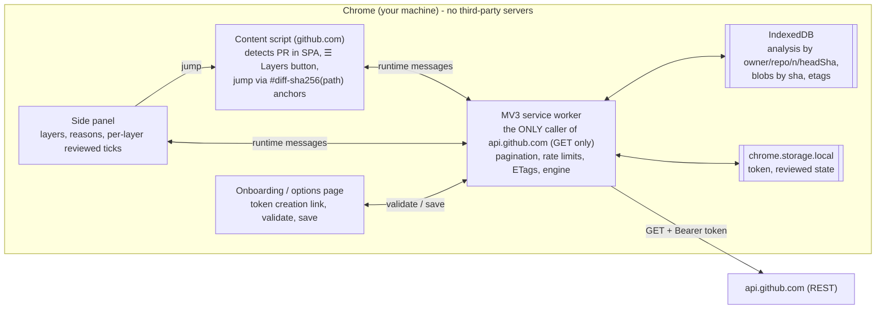

# PR Layers: review big GitHub PRs layer by layer

PR Layers is a Chrome extension (Manifest V3) for **human** code review. It reads a large GitHub pull request and groups its files into ordered **layers**:

> mechanical → contracts & schemas → core → callers (by import depth) → standalone → deleted code → tests → config/docs/assets → generated & lockfiles

You can then review bottom-up, one layer at a time. The layers show up in Chrome's side panel next to the PR. Each file comes with a one-line reason for its placement (e.g. *"imports lib/db.ts [Core]; used by pages/Profile.tsx"*), and clicking it jumps to that file in **Files changed**.

- **Read-only.** It only sends `GET` requests, using a fine-grained token you create with *Pull requests: Read-only* and *Contents: Read-only*.
- **Local.** There's no backend. PR code never leaves your browser. Results are cached in IndexedDB.
- **Deterministic.** Layers come from path/type rules plus a real import graph. No AI is involved.
- **Languages:** JS/TS, React (JSX/TSX), Vue SFCs (`<script>` / `<script setup>`), Node.js (ESM + `require`), Go, Python.

This is the Week-1 MVP of the reviewer-side "virtual stack" described in the product plan. It doesn't change the repo or the PR.

---

## Install (load unpacked)

1. Get the build: either unzip `pr-stacks-extension.zip`, or build it yourself (`npm ci && npm run build` gives you `dist/`).
2. In Chrome, open `chrome://extensions` and turn on **Developer mode** (top right).
3. Click **Load unpacked** and select the unzipped folder (or `dist/`).
4. The **setup page opens automatically** on first install. You can reopen it later from the extension's **Details → Extension options**, or with **Set up token** in the side panel.
5. Pin the extension. Open any PR on github.com, then click the toolbar icon or the green **☰ Layers** button at the bottom-right of the page.

Chrome 116+ is required (`chrome.sidePanel`).

## Onboarding: create a read-only fine-grained token

The setup page has a **pre-filled** link to GitHub's token form. It uses GitHub's documented template URL parameters ([docs](https://docs.github.com/en/authentication/keeping-your-account-and-data-secure/managing-your-personal-access-tokens#pre-filling-fine-grained-personal-access-token-details-using-url-parameters), [changelog](https://github.blog/changelog/2025-08-26-template-urls-for-fine-grained-pats-and-updated-permissions-ui/)):

```
https://github.com/settings/personal-access-tokens/new
  ?name=PR+Layers+(read-only)
  &description=...
  &target_name=<your org, e.g. Wayground's GitHub org slug>
  &expires_in=90
  &pull_requests=read
  &contents=read
```

On GitHub:

1. **Token name:** pre-filled as `PR Layers (read-only)`.
2. **Expiration:** pre-filled to 90 days. Avoid "No expiration".
3. **Resource owner:** your organization. Type its slug on the setup page to pre-fill `target_name`.
   - **SAML SSO orgs:** fine-grained tokens are SSO-authorized *during creation* ([docs](https://docs.github.com/en/enterprise-cloud@latest/authentication/authenticating-with-single-sign-on/authorizing-a-personal-access-token-for-use-with-single-sign-on)). If the org doesn't appear under Resource owner, first open the org on github.com and sign in through SSO, then reload the token page. Fine-grained tokens have no separate "Configure SSO" step; that step only exists for classic tokens.
   - If the org **requires approval** for fine-grained tokens, the token stays *pending* until an admin approves it. Until then it can only read public repos.
4. **Repository access:** pick *Only select repositories* and choose the repos you review. GitHub can't pre-fill this field.
5. **Permissions:** *Pull requests: Read-only* and *Contents: Read-only* (both pre-filled). *Metadata: Read-only* gets added automatically. **Add nothing else.**
6. Click **Generate token** and copy it (`github_pat_…`).

Back on the setup page:

7. Paste the token. Optionally enter a **private** `owner/repo` to test against.
8. Tick the confirmation box (see the next section for why), then click **Validate & save**.

The token is stored in `chrome.storage.local` on this device. It's only ever sent as the `Authorization` header of `GET` requests to `api.github.com`. **Remove token** on the setup page deletes it.

## Why write tokens are rejected, and what can and can't be detected

PR Layers needs read access only, so it refuses tokens it can tell are write-capable. Every check uses read-only `GET` requests. **The extension never sends a write request to probe a token.**

| Check | How | Reliable? |
|---|---|---|
| Classic PAT (`ghp_…`, or a legacy 40-hex token) | Token prefix ([token formats](https://github.blog/engineering/platform-security/behind-githubs-new-authentication-token-formats/)) | ✅ **Rejected outright.** Classic tokens can't be limited to read-only PR access. |
| OAuth / GitHub App tokens (`gho_`, `ghu_`, `ghs_`, `ghr_`) | Prefix | ✅ Rejected (not a personal token) |
| Any write-capable OAuth scope (`repo`, `public_repo`, `workflow`, `write:*`, `admin:*`, `delete_repo`, `gist`, `user`, …) | `X-OAuth-Scopes` header on `GET /user` ([docs](https://docs.github.com/en/apps/oauth-apps/building-oauth-apps/scopes-for-oauth-apps)). Only an allow-list of `read:*` scopes and `user:email` counts as read-only. | ✅ for scope-based tokens. A token that reports *any* scopes header while claiming to be fine-grained is also rejected. |
| Token is valid, owner login | `GET /user` → 200 | ✅ |
| Expired / revoked | 401 | ✅ |
| SSO required | 403 + `X-GitHub-SSO` ([docs](https://docs.github.com/en/rest/authentication/authenticating-to-the-rest-api)) | ✅ (shown with a fix) |
| Token can read PRs and contents of a test repo | `GET /repos/{o}/{r}`, `GET …/pulls`, `GET …/contents/` | ✅ for **private** repos. Public repos are readable without any permission, so they prove nothing. |
| Expiry date | `GitHub-Authentication-Token-Expiration` response header, when present | ⚠️ Shown if present. Not relied on: I couldn't find this header in the docs I checked. |
| **Fine-grained token (`github_pat_…`) has write permissions** (e.g. *Pull requests: Read and write*, *Contents: Read and write*, or anything extra) | — | ❌ **Not detectable without a write.** |

**Why the fine-grained case can't be detected.** Fine-grained tokens don't report their permissions in any header ([no `X-OAuth-Scopes`](https://github.com/github/github-mcp-server/blob/main/docs/scope-filtering.md)). `X-Accepted-GitHub-Permissions` only says what an endpoint *requires*, not what the token *has* ([docs](https://docs.github.com/en/rest/using-the-rest-api/troubleshooting-the-rest-api)). The repo endpoint's `permissions` field describes the **user's** role, not the token's, so PR Layers ignores it. The API that lists fine-grained tokens and their permissions is only for org admins, and only GitHub Apps can call it ([docs](https://docs.github.com/en/rest/orgs/personal-access-tokens)). The only other way to find out would be to attempt a write, and the extension never does that.

**What PR Layers does instead:**

1. The pre-filled link requests only `pull_requests=read` and `contents=read`.
2. You confirm with a checkbox that the token has only those permissions. Saving is blocked until you do.
3. The setup page explains how to check. On GitHub, go to **Settings → Developer settings → Fine-grained tokens → your token**. Every permission there should say *Read-only*.
4. As defense in depth, the extension can't write. `GitHubClient` only issues `GET` (unit-tested). The extension pages' CSP limits `connect-src` to `https://api.github.com`. The extension has no code path for POST, PATCH, PUT or DELETE.

## How the layering works

1. **Fetch** (service worker only): the PR metadata (ETag-cached), then `GET /pulls/{n}/files` paginated at 100 per page up to GitHub's 3000-file cap. It also fetches full head contents for modified code files (at most 150 by default, 6 in parallel, cached by blob SHA), plus `.gitattributes` and `go.mod`.
2. **Classify** each file:
   - *generated*: `.gitattributes` `linguist-generated`/`linguist-vendored`; lockfiles (`package-lock.json`, `yarn.lock`, `pnpm-lock.yaml`, `go.sum`, `poetry.lock`, `uv.lock` …); `*.min.js`; `dist/`; `vendor/`; `*.pb.go`; `_pb2.py`; snapshots; `Code generated … DO NOT EDIT` / `@generated` headers.
   - *mechanical*: rename-only, copy-only, or formatting-only (same tokens before and after).
   - *test*: `*.test|spec.*`, `__tests__/`, `*_test.go`, `test_*.py`, `*_test.py`, `tests/`, `conftest.py`, Cypress.
   - *contract*: `.proto`, GraphQL, OpenAPI, versioned migrations, `.sql`, `.d.ts`, `types/`, `*.types.ts`, `schema(s)`.
   - *config*, *docs/assets*, and everything else is *source*.
3. **Imports:**
   - JS/TS/JSX/TSX: ESM, re-exports, dynamic `import()`, `require`, `jest.mock`/`vi.mock`. Comments and strings are masked out first.
   - Vue: every `<script>` block, plus `<script src>` and `<style src>`.
   - Go: grouped, aliased, blank and dot imports.
   - Python: `import`, `from … import`, relative imports, parenthesised lists.
4. **Resolve** imports only against *changed* files:
   - JS: relative paths, extension and `index.*` probing, `.js`→`.ts`, and the `@/`/`~/` aliases (looked up per monorepo package).
   - Go: `go.mod` module path, or a directory-suffix match when there's no `go.mod`.
   - Python: relative imports, plus absolute imports matched by path suffix (works with `src/` layouts).
   - Go files in the same package are also linked when they use each other's new top-level identifiers. A Go package is kept in one layer.
5. **Graph:** Tarjan SCCs keep import cycles together. Depth is the longest import path down to code that depends on no other changed code.
   - *Core* = depth 0 with dependents.
   - *Callers · level k* = depth k (capped at 4+).
   - *Standalone* = no links to other changed files.
   - Layers with more than 25 files are split by package directory.
6. **Tests** are paired with their subject: first by imports and name, then name only, then Go same-package. They're ordered to follow their subject's layer.
7. **Reasons:** every file gets a sentence explaining its placement.

### Sample output (real public PRs)

Full outputs are in [`docs/samples/`](docs/samples). Regenerate them with `npm run analyze-pr -- owner/repo#123`, which needs the `gh` CLI.

| PR | Files | Layers |
|---|---|---|
| go-gitea/gitea#39426 (Go) | 57 | Core: `modules/egress/policy/` → Callers 1: `modules/setting/` → 2: `gitcmd`, `proxy` → 3: `egress`, `git` → 4+: services/routers/cmd → Deleted code → 25 tests → config |
| vbenjs/vue-vben-admin#8233 (Vue + TS monorepo) | 44 | Core: modal/drawer APIs + contracts → Callers 1: `use-modal`/`use-drawer`, typed demos → 2: `index.ts`/`index.vue` → Standalone → Tests → Docs |
| excalidraw/excalidraw#12018 (React/TS) | 63 | Contracts: `types.ts` → Core: `renderEnvironment.ts`, `appState.ts` … → Callers 1–4+ → Standalone → 15 tests → config |
| fastapi/fastapi#16403 (Python) | 36 | Core: `telemetry/_api.py` → Callers 1: routing, `_asgi`, `_runtime` → 2: `applications.py` → 20 tests → docs/config → `uv.lock` |

## Architecture



- **Content script:** runs on `https://github.com/*`, not just `/pull/*`, because GitHub navigates without page reloads. It only acts on `/{owner}/{repo}/pull/{n}` URLs. It never calls the API.
- **Service worker:** handles auth, API calls (rate-limit errors carry the reset time, secondary limits retry with backoff, 5xx retries), caching, and runs the engine (pure TypeScript, no DOM).
- **Jump to file:** sets `location.hash` to `diff-<sha256(path)>`, which is GitHub's per-file anchor, and leaves the scrolling to GitHub. If the tab isn't on Files changed, it navigates to `/pull/n/files#diff-…`.

## Development

```bash
npm ci
npm run typecheck     # tsc --noEmit
npm test              # vitest (classifier, import parsing per language, resolution, layering, token validation, API client)
npm run build         # esbuild -> dist/
npm run package       # typecheck + test + build + /workspace/pr-stacks-extension.zip
npm run analyze-pr -- go-gitea/gitea#39426   # run the engine on a real PR via `gh api` (read-only)
```

Settings are in `config/extension.config.json`: content-fetch limits, the API version, and `defaultTokenOwner` to pre-fill the org on the setup page. Rebuild after editing it.

### Project structure

```
config/extension.config.json   build-time settings
public/manifest.json, icons/   MV3 manifest + icons
src/background/                sw.ts (messages, analysis pipeline), github.ts (GET-only client), auth.ts (PAT), cache.ts (IndexedDB)
src/content/content.ts         PR detection, Layers button, jump-to-file
src/panel/                     side panel (plain TS, no framework)
src/options/                   onboarding / options page
src/shared/                    messages, PR URL + anchor, token-validation (pure, tested)
src/engine/                    classify, patch, glob(.gitattributes), imports/{js,vue,go,python}, resolve, graph (SCC/depth), analyze (layers + reasons)
test/                          vitest suites + fixtures
scripts/                       build.mjs, zip.py, analyze-pr.ts
docs/samples/                  engine output for real public PRs
```

## Known limitations (Week 1)

- **Not tested on live github.com UI yet.** The engine and API client are tested against real PR data and mocks. The side panel, the content script and the `#diff-…` jump still need a manual check in Chrome. Opening the side panel from the in-page button relies on the click counting as a user gesture through the message to the service worker. If it doesn't, use the toolbar icon, which always works.
- **File-level only.** A file whose hunks belong in different layers is placed whole. Splitting by hunk is planned for Week 2.
- **Partial view for modified files beyond the cap.** Full contents are fetched for up to 150 modified code files. Others are parsed from the diff, so imports outside the changed hunks are missed (a warning is shown).
- **Alias resolution:** only `@/` and `~/` → `src/` for now. `tsconfig` `paths`, Vite aliases and workspace package names (`@scope/pkg` in monorepos) aren't resolved yet, so cross-package edges are missing.
- Reviewed ticks are per layer and per head SHA, and stored locally only. Nothing syncs with GitHub's "Viewed" checkboxes.
- github.com only (no GHES). PRs beyond 3000 files are truncated by GitHub's API.
- Heuristic categories can be wrong for unusual layouts (e.g. a `schema/` folder that isn't a schema). Reasons make that visible. Overrides are planned for Week 2.

## Roadmap

**Week 2:**
- hunk-level assignment for mixed files;
- `tsconfig`/`jsconfig` `paths` + Vite aliases + workspace package names;
- per-layer file filter/stepper overlay on Files changed;
- drag-to-move overrides;
- sync reviewed state with GitHub "Viewed" (would need a write, so opt-in or skipped);
- live UI test pass on Wayground PRs;
- per-file reviewed state that survives new pushes (by blob SHA).

**Week 3:**
- author-pinned plan (hidden PR comment, optional write: needs a separate opt-in token);
- shareable `.stack` export for the local CLI that does real stacked-PR splits;
- CODEOWNERS-aware layer owners;
- metrics (time-to-first-review on layered vs. unlayered PRs).
